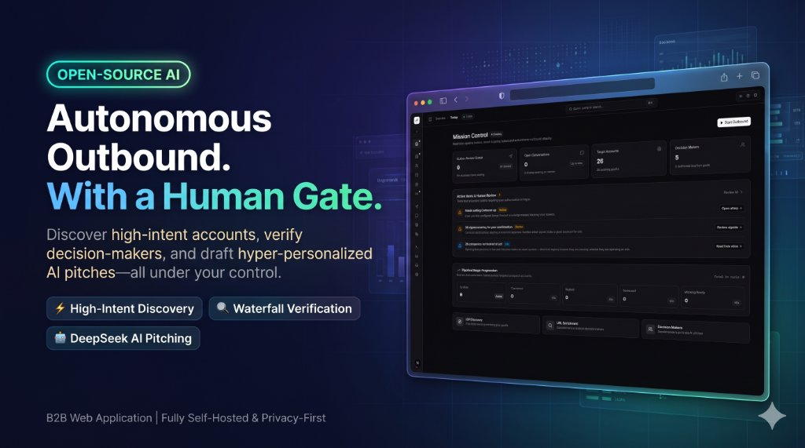
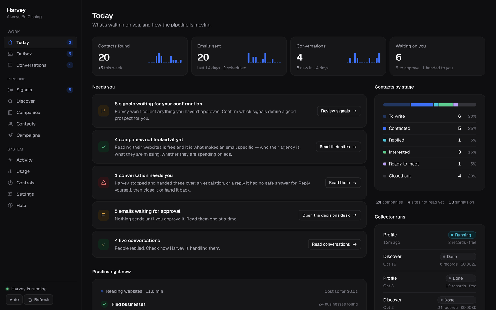
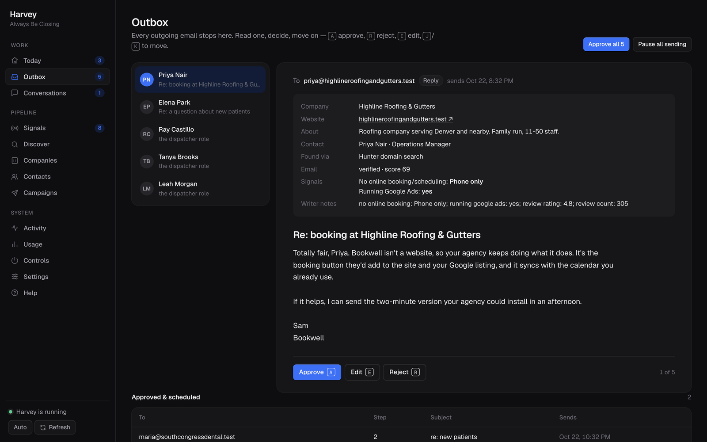
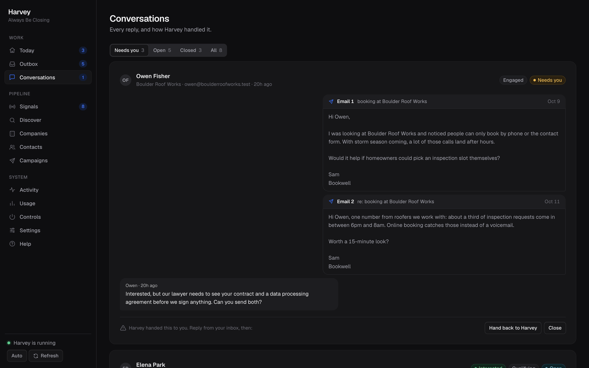
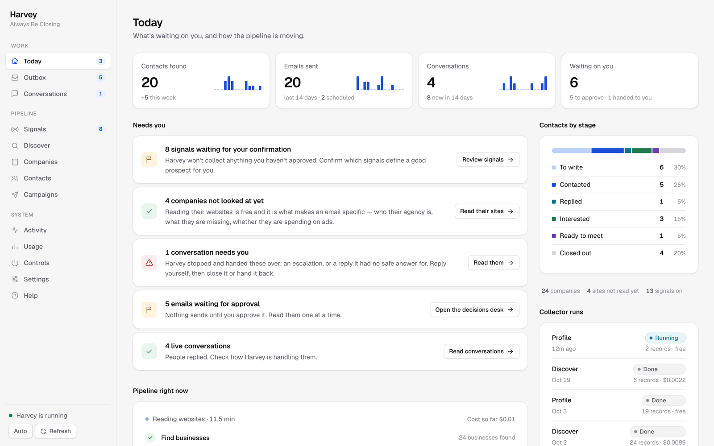
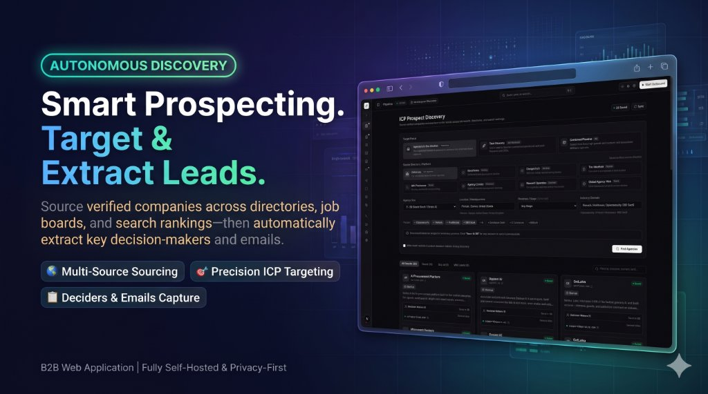
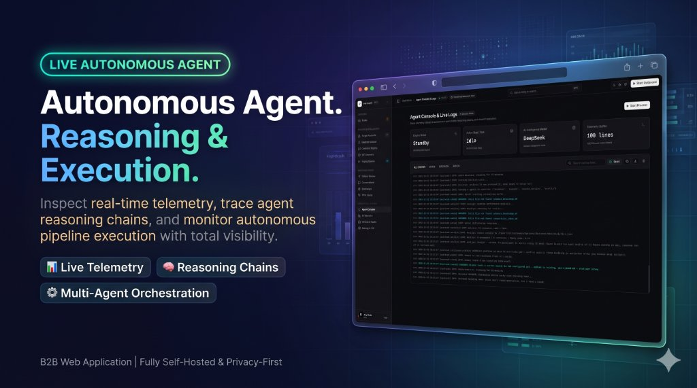
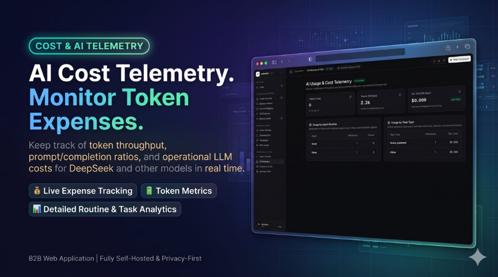

<p align="center">
  <a href="https://github.com/vanshsingh3711-wq/Outreach">
    <picture>
      <source media="(prefers-color-scheme: dark)" srcset="docs/brand/outreach-wordmark-white.svg">
      
    </picture>
  </a>
</p>

<p align="center">
  <strong>The Autonomous AI Outbound Pipeline & Prospecting Platform.</strong><br>
  <em>Discovers high-intent accounts, identifies technical decision-makers, derives verified emails, crafts hyper-personalized pitches via DeepSeek AI, and automates multi-inbox deliverability.</em>
</p>

<p align="center">
  <a href="https://outreach-alpha-gules.vercel.app/"></a>
  <a href="https://github.com/vanshsingh3711-wq/Outreach"></a>
  <a href="LICENSE"></a>
  
  
  
  
  
</p>

<p align="center">
  <a href="https://outreach-alpha-gules.vercel.app/">🌐 <strong>Live Demo</strong></a> &nbsp;•&nbsp;
  <a href="#quick-start">🚀 Quick Start</a> &nbsp;•&nbsp;
  <a href="#platform-features">✨ Features</a> &nbsp;•&nbsp;
  <a href="#modern-b2b-web-application">🖥️ Web Application</a> &nbsp;•&nbsp;
  <a href="#the-outreach-difference">📊 Comparison</a> &nbsp;•&nbsp;
  <a href="#system-architecture">🏗️ Architecture</a> &nbsp;•&nbsp;
  <a href="#cli-command-reference">⚡ CLI Reference</a> &nbsp;•&nbsp;
  <a href="#enterprise-security--compliance">🔒 Security</a>
</p>

<p align="center">
  <a href="https://outreach-alpha-gules.vercel.app/">
    
  </a>
</p>

> 🚀 **Live Interactive Application**: Test the live deployment at [**outreach-alpha-gules.vercel.app**](https://outreach-alpha-gules.vercel.app/) — test the keyboard-driven outbox review desk (<kbd>A</kbd>/<kbd>R</kbd>/<kbd>E</kbd>), collapsible navigation (<kbd>⌘B</kbd>), global command palette (<kbd>⌘K</kbd>), and DeepSeek AI pitch generation.

---

## Executive Overview

Modern B2B growth teams waste thousands of dollars per month on fragmented, opaque sales stacks (Apollo + Clay + Smartlead + Lemlist + OpenAI) that scrape generic contact lists, blast low-relevance AI spam, and inevitably ruin company domain reputations.

**Outreach** is an open-source, privacy-first autonomous prospecting platform designed for modern software agencies, AI consultancies, and B2B SaaS teams. It automates the full outbound lifecycle:

1. **High-Intent Discovery**: Detects accounts actively hiring, raising capital, or adopting modern tech stacks (e.g. LangGraph, FastAPI, PyTorch, Qdrant).
2. **Hardened SSRF-Defended Crawling**: Deep-crawls corporate assets with DNS-rebinding protection and cloud metadata shielding.
3. **Leadership Intelligence**: Maps key technical leadership (CTOs, VPs of Engineering, Heads of AI, Technical Founders) with prioritized seniority rankings.
4. **Waterfall Email Verification**: Derives company address patterns (`{first}.{last}`) and performs dual-stage verification (Reoon, ZeroBounce, Hunter, native MX handshakes) to guarantee < 1% bounce rates.
5. **Contextual Pitch Studio**: Uses DeepSeek AI to synthesize company tech stacks, hiring pains, and value propositions into authentic, anti-fluff cold pitches.
6. **Strict Human-in-the-Loop Review Desk**: Every single email lands in your staging outbox. Zero automated cold sends ever occur without explicit human approval (<kbd>A</kbd> Approve, <kbd>R</kbd> Reject, <kbd>E</kbd> Edit).
7. **Autonomous Dispatch & Reply Intelligence**: Rotates mailboxes, respects local recipient office hours, and categorizes inbound responses (Interested, Objection, Out of Office).

---

## Modern B2B Web Application

> 🌐 **Live Demo Application**: [**https://outreach-alpha-gules.vercel.app**](https://outreach-alpha-gules.vercel.app/)

Outreach includes a high-performance web dashboard built with **Next.js 16**, **React 19**, **Tailwind CSS v4**, and **Lucide Icons**. It delivers a clean, keyboard-first B2B interface with full light and dark mode parity.

| Mission Control (Today Queue) | Master-Detail Outbox Review |
|:---:|:---:|
|  |  |
| *Real-time funnel conversion, pending review queue & system health* | *High-velocity triage with hotkeys (`A`, `R`, `E`, `J`, `K`)* |

| Split Inbox & Conversations | Collapsible Navigation & Command Palette |
|:---:|:---:|
|  |  |
| *Threaded replies, sentiment classification & fast response drafts* | *Global `⌘K` command palette & `⌘B` collapsible sidebar* |

### Built for Power Users & Fast SDR Workflows:
- **`⌘K` / `Ctrl+K` Global Command Palette**: Jump to any account, contact, or operational view instantly.
- **`⌘B` / `Ctrl+B` Collapsible Shell**: Maximize workspace density with a collapsible desktop sidebar and responsive mobile drawer.
- **Single-Key Outbox Triage**: Process 50+ drafted emails in under 3 minutes using <kbd>A</kbd> (Approve), <kbd>R</kbd> (Reject), <kbd>E</kbd> (Edit), and <kbd>J</kbd>/<kbd>K</kbd> (Navigate).
- **Sub-100ms UI Latency**: Powered by `@tanstack/react-query` with optimistic state caching.

---

## Platform Features

```
┌────────────────────────────────────────────────────────────────────────────────────────┐
│                                 OUTREACH PIPELINE ENGINE                               │
├─────────────────────┬─────────────────────┬─────────────────────┬──────────────────────┤
│  1. TARGET ACCOUNTS │  2. ENRICH & VERIFY │  3. SYNTHESIZE      │  4. REVIEW & DISPATCH│
├─────────────────────┼─────────────────────┼─────────────────────┼──────────────────────┤
│ • ICP Filtering     │ • SSRF-Safe Crawler │ • DeepSeek LLM      │ • Human Gate Desk    │
│ • Tech Stack Cues   │ • Team Scraping     │ • Anti-Fluff Hooks  │ • Keyboard Triage    │
│ • Hiring Triggers   │ • Email Waterfall   │ • Value Prop Fit    │ • Multi-Inbox Send   │
│ • Domain Discovery  │ • MX Handshakes     │ • 4 Pitch Profiles  │ • Inbound Classifier │
└─────────────────────┴─────────────────────┴─────────────────────┴──────────────────────┘
```

### 1. High-Intent Account Discovery

<p align="center">
  
</p>

Find companies matching exact firmographic criteria, tech stacks, and job openings. Filter targets adopting cutting-edge tools (e.g. LangChain, Qdrant, FastAPI, PyTorch) or experiencing engineering hiring crunches.

### 2. SSRF-Defended Corporate Enrichment
Safely inspect target domains. The crawler analyzes Home, About, Team, and Career pages with hardened protection against loopbacks (`127.0.0.1`), RFC-1918 private subnets, and AWS/GCP metadata endpoints (`169.254.169.254`).

### 3. Decision-Maker Intelligence & Social Graphs
Pinpoints high-leverage technical leadership based on company size:
- **Early Stage (1–20)**: Founders, Co-Founders, CEO, CTO.
- **Growth (21–100)**: CTO, VP of Engineering, Head of AI/ML.
- **Scale-Up (100+)**: Director of Engineering, Staff AI Engineers.
- Automatically discovers verified **LinkedIn**, **𝕏 (Twitter)**, and **GitHub** profiles.

### 4. Zero-Bounce Deliverability Waterfall
Never risk your domain reputation. Outreach derives company email patterns (`first.last@company.com`, `f.last@company.com`) and validates them through a multi-tier pipeline:
1. Native MX record & DNS verification
2. Multi-provider API waterfall (Reoon, ZeroBounce, Hunter)
3. Catch-all domain detection and honest deliverability labeling

### 5. 4 Specialized Value Proposition Archetypes
Outreach crafts hyper-relevant, bespoke hooks across 4 core business profiles:
- **Freelance / Fractional Development**: Overflow dev bandwidth, rapid prototyping, and full-stack execution.
- **Applied AI Engineering**: Custom RAG pipelines, fine-tuning, inference latency optimization, and agentic workflows.
- **Technical Career / AI Engineer Hiring**: Proactive positioning for high-growth startups hiring AI talent.
- **Workflow Automation & Agentic Systems**: Multi-agent systems (LangGraph), internal automation, and CRM integrations.

### 6. Strict Human-in-the-Loop Review Desk
Unlike black-box email blasters, Outreach implements a hard approval gate:
- Drafts land in `pending_review`.
- Review the personalized hook, subject line, and recipient context.
- Approve (<kbd>A</kbd>), reject (<kbd>R</kbd>), or edit (<kbd>E</kbd>) directly from the dashboard or CLI.
- No cold message ever leaves your machine without explicit confirmation.

---

## The Outreach Difference

| Feature | Outreach (Open-Source) | Apollo.io / ZoomInfo | Clay.com | Lemlist / Smartlead |
|---|:---:|:---:|:---:|:---:|
| **Monthly Software Cost** | **$0 (Free & Open Source)** | $99 – $1,200/mo | $149 – $800/mo | $59 – $150/mo |
| **Data Ownership & Privacy** | **100% Self-Hosted & Local** | Stored on their servers | Cloud vendor lock-in | Stored on their servers |
| **Zero Automated Sends Guarantee** | **Yes (Hard Human Gate)** | No (Auto-blaster) | No (Scripted sends) | No (Automated blast) |
| **LLM Personalization Quality** | **DeepSeek-V3 / Claude 3.5** | Template tokens (`{{firstName}}`) | Formulaic credits | Basic OpenAI prompt |
| **SSRF Enterprise Crawler Protection**| **Yes (DNS Pinning + Filter)** | N/A | Proprietary | N/A |
| **Extensible Python & Next.js Core** | **Yes (Full Source Code)** | Closed Source | Closed Source | Closed Source |
| **Multi-Provider Email Verification**| **Native Waterfall Included** | Paid Add-on | Paid credits per row | External webhook |

---

## Quick Start

Get Outreach running locally in under two minutes:

### 1. Prerequisites
- **Python**: 3.11 or higher
- **Node.js**: v18.18+ or v20+ (with `pnpm`)
- **Git**

### 2. Clone & Setup Python Environment

```bash
# Clone the repository
git clone https://github.com/vanshsingh3711-wq/Outreach.git
cd Outreach

# Create and activate virtual environment
python3 -m venv .venv
source .venv/bin/activate

# Install core package in editable mode
pip install -e .

# (Optional) Install browser rendering engine for dynamic sites
playwright install chromium
```

### 3. Setup Frontend Workspace

```bash
cd frontend
pnpm install
cd ..
```

### 4. Configure Environment Variables

```bash
cp .env.example .env
```

Edit `.env` with your preferred providers:

```ini
# DeepSeek AI (Recommended: High intelligence, low inference cost)
DEEPSEEK_API_KEY=sk-...
DEEPSEEK_MODEL=deepseek-chat

# Search & Discovery Engine (Google Search)
SERPER_API_KEY=...

# Email Verification (Pick one or more)
REOON_API_KEY=...
ZEROBOUNCE_API_KEY=...
HUNTER_API_KEY=...

# Mailbox Provider (Gmail OAuth, Microsoft 365 Graph, or SMTP)
GMAIL_CLIENT_ID=...
GMAIL_CLIENT_SECRET=...
```

### 5. Launch the Platform

Run both backend engine and Next.js frontend in development mode:

```bash
# Terminal 1: Start Backend API & Agent Engine (Port 5555)
pnpm backend

# Terminal 2: Start Modern Web Dashboard (Port 3000)
pnpm frontend
```

Visit **`http://localhost:3000`** in your browser.

> **One-Command Standalone Mode**: Run `outreach dashboard` to launch the self-contained FastAPI dashboard with integrated token security.

---

## Configuration (`outreach.yaml`)

Define your company identity, value proposition, and ICP criteria in `outreach.yaml`:

```yaml
persona:
  name: "Alex Vance"
  company: "Apex AI Studio"
  role: "Principal AI Engineer"
  email: "alex@apex-ai.studio"
  linkedin: "linkedin.com/in/alex-vance"
  tone: "concise, engineering-led, consultative"

product:
  name: "Custom Multi-Agent & RAG Systems"
  description: "Production LLM backends, LangGraph multi-agent automation, and low-latency vector search."
  key_benefits:
    - "Production-ready AI architectures deployed in weeks, not quarters"
    - "Elimination of repetitive manual workflows with reliable multi-agent orchestration"
    - "Seamless integration with existing FastAPI, PostgreSQL, and cloud stacks"
  offer:
    primary: "14-day applied AI sprint"
    goal: "book_call"
    booking_url: "https://cal.com/alex-vance/15min"

icp:
  industries:
    - "Artificial Intelligence"
    - "B2B SaaS"
    - "Digital Health"
  titles:
    - "Chief Technology Officer"
    - "VP of Engineering"
    - "Head of AI"
    - "Technical Co-Founder"
  tech_stack_keywords:
    - "LangGraph"
    - "FastAPI"
    - "PyTorch"
    - "Qdrant"
```

---

## CLI Command Reference

Outreach features a robust command-line interface for automation, cron jobs, and terminal power users:

| Command | Description | Example |
|---|---|---|
| `outreach dashboard` | Start local web mission control | `outreach dashboard --port 5555` |
| `outreach discover-companies` | Run autonomous company discovery | `outreach discover-companies --industry "AI" --tech "FastAPI" --limit 15` |
| `outreach enrich <url>` | Deep-crawl and enrich corporate domain | `outreach enrich https://agentic.io --json` |
| `outreach run` | Run background heartbeat & send loop | `outreach run --interval 60` |
| `outreach status` | Display pipeline health and queue metrics | `outreach status` |
| `outreach outbox` | CLI review desk for pending emails | `outreach outbox --interactive` |

---

## System Architecture

```
                                  ┌────────────────────────┐
                                  │      Next.js 16        │
                                  │   React 19 Dashboard   │
                                  │   (Tailwind CSS v4)    │
                                  └───────────┬────────────┘
                                              │ HTTP / JSON
                                              ▼
┌────────────────────────────────────────────────────────────────────────────────────────┐
│                                 FASTAPI BACKEND ENGINE                                 │
│                                (outreach/dashboard.py)                                 │
└───────┬───────────────────┬───────────────────┬───────────────────┬────────────────────┘
        │                   │                   │                   │
        ▼                   ▼                   ▼                   ▼
┌──────────────┐    ┌──────────────┐    ┌──────────────┐    ┌──────────────┐
│  Discovery   │    │  Enrichment  │    │ Email Intel  │    │  Agent Core  │
│    Engine    │    │ & SSRF Guard │    │ & Waterfall  │    │ & Heartbeat  │
├──────────────┤    ├──────────────┤    ├──────────────┤    ├──────────────┤
│ • Serper     │    │ • Playwright │    │ • Reoon      │    │ • DeepSeek   │
│ • DataForSEO │    │ • BeautifulSoup│  │ • ZeroBounce │    │ • Claude     │
│ • OSM Maps   │    │ • DNS Pinning│    │ • Hunter     │    │ • Outbox DB  │
└──────────────┘    └──────────────┘    └──────────────┘    └──────────────┘
                                                                    │
                                            ┌───────────────────────┴────────────────────┐
                                            ▼                                            ▼
                                  ┌───────────────────┐                        ┌───────────────────┐
                                  │  SQLite / Storage │                        │ Mail Infrastructure│
                                  │ (Local & Private) │                        │ (Gmail, O365, SMTP)│
                                  └───────────────────┘                        └───────────────────┘
```

### Autonomous Agent Reasoning & Execution

<p align="center">
  
</p>

Inspect real-time telemetry, trace agent reasoning chains, and monitor autonomous pipeline execution with total visibility:
- **Live Streaming Terminal & Logs**: Watch the Scout agent discover accounts, enrich domains, and probe MX records in real time.
- **Engine State & Process Control**: Start, stop, or toggle between Autonomous mode and Standby with instant background process control.
- **Reasoning Chains & Multi-Agent Orchestration**: Complete visibility into whether pitches were synthesized via DeepSeek-V3 or generated through structured heuristics.

---

## Multi-Provider Support

Outreach is designed with zero vendor lock-in. Swap or cascade providers effortlessly:

| Layer | Primary / Recommended | Fallbacks & Alternatives |
|---|---|---|
| **AI Intelligence** | **DeepSeek** (`deepseek-chat`, `deepseek-reasoner`) | Anthropic Claude (`claude-3-5-sonnet`), Local Ollama |
| **Web Discovery** | **Serper** (Google Search API) | DataForSEO, Scavio, OpenStreetMap |
| **Enrichment Crawler** | **Native HTTPX + BeautifulSoup** | Playwright Chromium (Headless JS rendering) |
| **Email Verification** | **Native MX Handshake** | Reoon, ZeroBounce, Hunter.io |
| **Email Dispatch** | **Gmail API (OAuth 2.0)** | Microsoft 365 (Graph API), Custom SMTP/IMAP |
| **Mailbox Warmup** | **TrulyInbox** integration | Native ramp-up schedule & throttles |

### AI Cost Telemetry & Token Accounting

<p align="center">
  
</p>

Keep track of token throughput, prompt/completion ratios, and operational LLM expenses in real time:
- **Live Expense Tracking**: Monitor aggregate 30-day and per-routine inference costs for DeepSeek and Claude models.
- **Token Efficiency Metrics**: Track token consumption broken down by routine (Scout, Researcher, Copywriter) and task type (`score_contacts`, `draft_pitch`).
- **Cost-Per-Lead Analytics**: Optimize your prospecting ROI with precise per-account unit economics.

---

## Enterprise Security & Compliance

1. **SSRF Defense Architecture**:
   - The crawler enforces strict URL validation before connecting:
   - Prohibits loopback (`127.0.0.0/8`, `::1`), link-local (`169.254.0.0/16`), and private RFC-1918 subnets (`10.0.0.0/8`, `172.16.0.0/12`, `192.168.0.0/16`).
   - Rejects non-HTTP/HTTPS schemes and unauthorized port bindings.
2. **Zero-Send Human Consent Gate**:
   - Outbox items strictly default to `pending_review`.
   - The background heartbeat daemon (`outreach run`) will **never** dispatch an email without explicit human approval.
3. **Local Data Sovereignty**:
   - Target accounts, contact rosters, email drafts, and CRM history remain stored strictly on your local SQLite instance.
   - Zero prospect data is sent to external clouds other than the AI model inference API you choose.
4. **Deliverability & CAN-SPAM Compliance**:
   - Automatic 1-click unsubscribe headers (`List-Unsubscribe`).
   - Office-hours sending constraints (respects target recipient's time zone).
   - Automated bounce suppression and mailbox cooldown algorithms.

---

## Contributing

We welcome contributions from developers, growth engineers, and AI practitioners.

```bash
# Run backend test suite
pnpm test

# Run frontend linting & TypeScript verification
pnpm --dir frontend lint
pnpm --dir frontend build
```

Please review our [CONTRIBUTING.md](CONTRIBUTING.md) and [CODE_OF_CONDUCT.md](CODE_OF_CONDUCT.md) before opening a pull request.

---

## License

Outreach is open-source software licensed under the **[GNU Affero General Public License v3.0](LICENSE)**.

---

<p align="center">
  Crafted for B2B engineering and growth teams who value authentic communication over automated spam.
</p>
